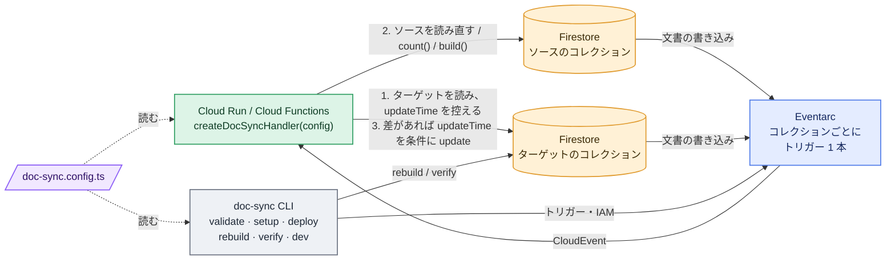

# firestore-denormalize

Firestore の派生データを、**Cloud Run 関数 1 つ ＋ コレクションごとの Eventarc トリガー**で正しく保ちます。

[English README](./README.md) · [リファレンス](./docs/reference.ja.md) · [Changelog](./CHANGELOG.md)

ルールは 1 つの TypeScript ファイルに記述します。関数は変更のたびにソースドキュメントを読み直し、ターゲットの `updateTime` を条件に、値が異なる場合だけ派生値を書き込みます。重複・遅延・順序が入れ替わったイベントが結果を壊すことはありません。

**Extensions や自前のトリガーではなく、これを選ぶ理由**

- ルールが何個あっても関数は 1 つ、トリガーはコレクションごとに 1 本です。`firestore-connect-*` 系 Extension の「ルール 1 つに関数 2 つ」や、ルールごとのトリガーは要りません。
- Eventarc の at-least-once・順序保証なしの配信でも正しく収束します。値はイベントから取らずに読み直し、`increment()` も使いません。
- `rebuild` が既存データをバックフィルし、`verify` が正しさを検証します。どちらも本番のハンドラと同じコードで動きます。
- `validate` が、デプロイ前に 1 イベントあたりの読み書き量を式で示します。

**ステータス**: 0.x です。API の形は固まっていますが 1.0 までに変わる可能性があり、本番プロジェクトでの検証はまだです。

## 3 つのルール

**コピー**（`connections`）: 1 文書のフィールドを、それを指すすべての文書にコピーします。

```ts
{
  name: 'post-category',
  source: 'category',
  target: 'post',
  idField: 'categoryId',
  fields: ['name', 'color'],
  targetField: 'category',
  onSourceDelete: 'setNull',
}
```
```
category/c1   { name: 'News', color: 'red', slug: 'news' }
post/p1       { title: 'Hello', categoryId: 'c1' }
                                   ▼
post/p1       { title: 'Hello', categoryId: 'c1', category: { name: 'News', color: 'red' } }
```

**件数・合計**（`aggregates`）: ターゲットに属する文書についての数値を、常に `count()` / `sum()` で再計算します。

```ts
{
  name: 'post-likes',
  source: 'post/{postId}/like',
  target: 'post',
  idParam: 'postId',
  aggregate: 'count', // または { sum: 'amount' }
  targetField: 'likeCount',
}
```
```
post/p1/like/u1, post/p1/like/u2
post/p1       { title: 'Hello' }
                                   ▼
post/p1       { title: 'Hello', likeCount: 2 }
```

**ビュー**（`views`）: 自前の `build` が 1 つ以上のソースから計算する値です。最新 N 件のリスト、ID をキーにしたマップ、サマリーなどに使います。

```ts
defineView({
  name: 'post-latest-comments',
  target: 'post',
  targetField: 'latestComments',
  sources: {
    comments: {
      collection: 'post/{postId}/comment',
      idParam: 'postId',
      orderBy: [['createdAt', 'desc']],
      limit: 2,
    },
  },
  build: ({ sources }) => sources.comments.map((c) => ({ id: c.id, body: c.get('body') })),
})
```
```
post/p1/comment/c1 { body: 'first', createdAt: 1 } … c3 { body: 'third', createdAt: 3 }
post/p1       { title: 'Hello' }
                                   ▼
post/p1       { title: 'Hello', latestComments: [{ id: 'c3', body: 'third' }, { id: 'c2', body: 'second' }] }
```

`patch`（ビュー用）や型付き設定を含む全オプションは [リファレンス](./docs/reference.ja.md#設定) にあります。

## 仕組み



1 が 2 より先に行われるので、古い読み取りから計算した値が 3 の前提条件を通ることはありません。詳細: [変更はこう処理される](./docs/reference.ja.md#変更はこう処理される)。

## クイックスタート

Node.js 20 以上、`firebase-admin` 12 以上、`gcloud` と `firebase` の CLI、Native モードの Firestore が必要です。

```sh
npm install firestore-denormalize
```

**1. 設定。** `doc-sync.config.ts` を `functions/src/` に置きます（`firebase deploy` がそこをデプロイするため）。完全な例: [examples/functions/src/doc-sync.config.ts](./examples/functions/src/doc-sync.config.ts)。

**2. 関数。** ハンドラを HTTP 関数として公開します。`invoker` は必須です。指定しないと関数が公開状態になります。

```ts
// functions/src/index.ts
import { initializeApp } from 'firebase-admin/app'
import { onRequest } from 'firebase-functions/v2/https'
import { createDocSyncHandler } from 'firestore-denormalize'
import config from './doc-sync.config'

initializeApp()

export const docSync = onRequest(
  { region: 'asia-northeast1', invoker: 'doc-sync-trigger@<project>.iam.gserviceaccount.com' },
  createDocSyncHandler(config),
)
```

**3. サービスアカウント、デプロイ、トリガー。**

```sh
npx doc-sync setup  --project <project> --config functions/src/doc-sync.config.ts   # 初回のみ: SA・IAM・API
firebase deploy --only functions:docSync
npx doc-sync deploy --project <project> --config functions/src/doc-sync.config.ts   # トリガーを作成・更新・削除
```

**4. 既存データ。**

```sh
npx doc-sync rebuild --project <project> --config functions/src/doc-sync.config.ts --dry-run   # その後 --dry-run なしで実行
npx doc-sync verify  --project <project> --config functions/src/doc-sync.config.ts             # 不整合があれば終了コード 1；--fix で修復
```

## CLI

```
doc-sync validate [--config <path>] [--strict]                       # 設定を検査し、コスト見積りを表示
doc-sync setup    [--config <path>] [--project <id>] [--dry-run]
doc-sync deploy   [--config <path>] [--project <id>] [--dry-run] [--deploy-function <name>]
doc-sync rebuild  [--config <path>] [--project <id>] [--dry-run] [--rule <name>]... [--start-after <path>] [--page-size <n>]
doc-sync verify   [--config <path>] [--project <id>] [--fix] [--rule <name>]... [--start-after <path>] [--page-size <n>]
doc-sync dev      [--config <path>] [--project <id>] --url <handler url> [--emulator-host <host:port>]
```

`validate` はルールごとに 1 イベントが引き起こす読み書き量を（該当ターゲット数の式で）表示し、コストの高い形を警告するので、デプロイ前にコストが見えます。`rebuild`、`verify`、`dev` は Application Default Credentials を使うか、`FIRESTORE_EMULATOR_HOST` / `--emulator-host` を設定すると Firestore エミュレータを使います。フラグの詳細: [リファレンス](./docs/reference.ja.md#cli)。

## ローカル開発

Emulator Suite には Eventarc がないため、`doc-sync dev` が Firestore エミュレータを監視し、各変更を Eventarc と同じように CloudEvent として関数に POST します。

```sh
firebase emulators:start --only firestore,functions
FIRESTORE_EMULATOR_HOST=127.0.0.1:8080 npx doc-sync dev --project demo-app \
  --config functions/src/doc-sync.config.ts --url http://127.0.0.1:5001/demo-app/asia-northeast1/docSync
```

## 次に読むもの

- [リファレンス](./docs/reference.ja.md): 全設定オプション、型付き設定、処理ルール、ログ、コストの見積もり、セキュリティ、制約、推奨する関数の設定。
- [ROADMAP](./ROADMAP.ja.md) と [CHANGELOG](./CHANGELOG.md)。

## 開発

```sh
npm install && npm run typecheck && npm test   # テストは Firestore エミュレータに対して実行されます（firebase-tools と Java が必要）
npm run build                                   # dist/ に ESM + CJS + .d.ts を出力
```

## ライセンス

MIT
