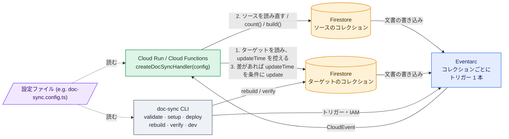

# firestore-denormalize

Firestore のドキュメント間のデータ同期を、**Cloud Run 関数 1 つ ＋ コレクションごとの Eventarc トリガー**で正しく処理します。

[English README](./README.md) · [リファレンス](./docs/reference.ja.md) · [Changelog](./CHANGELOG.md)

## ステータス
0.x ベータ版です。破壊的変更が起こる可能性があります。

## 特徴

- 👍 一つの関数で全てのコレクションのデータ同期を行います。関数の見通しが良くなるだけでなく、一つのインスタンスを起動しつづけるだけで、コールドスタートがなく迅速な同期を処理できます。
- 👍 functionsでデータ同期を行うことで、クライアントの書き込みルールをシンプルに保てます。
- 👍 Eventarc の 配信条件「最低1回・順序保証なし」を正しく処理し意図通りのデータを同期します。値はイベントから取らずに読み直し、`increment()` も使いません。
- 👍 `rebuild` により既存データをバックフィル可能です
- 👍 `verify` により保存データに同期漏れがないかの確認も可能です。
- 👍 `validate` により、デプロイ前に 1 イベントあたりの読み書き量を見積もれます
- 👍 どのルールもイベントの代わりに Cloud Scheduler の cron で実行できます（`schedule: '0 3 * * *'`）。関数は 1 つのままです。

## 本ライブラリでできること

すべての基本は **ビュー** です。ビューは「ターゲットのドキュメントの宣言したフィールドを、他のドキュメントから計算した値に保つ」ルールです。残りの 3 種類は、形の決まったビューを短く書くための簡易設定（ショートハンド）です。合うときはそれを使い、合わないときは `defineView` に戻ります。

**ビュー**（`defineView`）: 一般形です。ターゲット・ソース・`base` の変更を検知し、`targetFields` で宣言したフィールドパス（ルート直下でもネストでも）を書きます。最新 N 件のリスト、ID をキーにしたマップ、サマリー、読み取りモデルに使います。`base` を付けると、同じ ID の base ドキュメントに合わせてターゲットのドキュメント自体を作成・削除します。

```ts
defineView({
  name: 'post-latest-comments',
  target: 'post',
  targetFields: ['latestComments'],
  sources: {
    comments: {
      collection: 'post/{postId}/comment',
      idParam: 'postId',
      orderBy: [['createdAt', 'desc']],
      limit: 2,
    },
  },
  build: ({ sources }) => ({ latestComments: sources.comments.map((c) => ({ id: c.id, body: c.get('body') })) }),
})
```
```
post/p1/comment/c1 { body: 'first', createdAt: 1 } … c3 { body: 'third', createdAt: 3 }
post/p1       { title: 'Hello' }
                                   ▼
post/p1       { title: 'Hello', latestComments: [{ id: 'c3', body: 'third' }, { id: 'c2', body: 'second' }] }
```

**プロジェクション**（`defineProjection`）: `base` 付きで `build` の無いビューの簡易設定です。別コレクションの読み取りモデルで、`user/{id}` があるときだけ `userPublicView/{id}` が存在し、宣言したパスをそのまま写します。派生フィールドは `userPublicView` に対する aggregate や view で足します。

```ts
defineProjection({
  name: 'user-public',
  base: 'user',
  target: 'userPublicView',
  targetFields: ['displayName', 'avatarUrl'],
})
```
```
user/u1             { displayName: 'Ann', avatarUrl: '…', email: 'ann@…', phone: '…' }
                                   ▼
userPublicView/u1   { displayName: 'Ann', avatarUrl: '…' }
```

**コピー**（`defineConnection`）: `refField` ソースを 1 つ持つビューの簡易設定です。ドキュメントのフィールドを、それを参照する関連ドキュメントの 1 フィールド配下にコピーします。

```ts
defineConnection({
  name: 'post-category',
  source: 'category',
  target: 'post',
  idField: 'categoryId',
  fields: ['name', 'color'],
  targetField: 'category',
  onSourceDelete: 'setNull',
})
```
```
category/c1   { name: 'News', color: 'red', slug: 'news' }
post/p1       { title: 'Hello', categoryId: 'c1' }
                                   ▼
post/p1       { title: 'Hello', categoryId: 'c1', category: { name: 'News', color: 'red' } }
```

**件数・合計**（`defineAggregate`）: 値が件数または合計であるビューの簡易設定です。ドキュメントを読まずに Firestore の集計クエリを使うので、大きなコレクションでも安価です。

```ts
defineAggregate({
  name: 'post-likes',
  source: 'post/{postId}/like',
  target: 'post',
  idParam: 'postId',
  aggregate: 'count', // または { sum: 'amount' }
  targetField: 'likeCount',
})
```
```
post/p1/like/u1, post/p1/like/u2
post/p1       { title: 'Hello' }
                                   ▼
post/p1       { title: 'Hello', likeCount: 2 }
```

**イベントではなく定期実行**: どのルールにも `schedule` を付けると、Firestore のイベントではなく Cloud Scheduler のジョブが同じ関数（`/schedule/<rule>`）を呼んで同期します。大きなファンアウト、夜間の集計、遅れてよい読み取りモデルに。

```ts
defineAggregate({ name: 'daily-likes', source: 'post/{postId}/like', target: 'post', idParam: 'postId', aggregate: 'count', targetField: 'likeCount', schedule: '0 3 * * *', timeZone: 'Asia/Tokyo' })
```

connection・aggregate・`base` の無い view はターゲットを作りません。既存ドキュメントのフィールドを埋めるだけです。`base` 付きの view（と projection）だけが例外で、ターゲットの存在を所有します。

これらは設定の `rules` 配列に入れます。順序は自由なので、ドメインごとにまとめてファイルを分けられます。

`patch`（ビュー用）や型付き設定を含む全オプションは [リファレンス](./docs/reference.ja.md#設定) にあります。

## 仕組み



1 が 2 より先に行われるので、古い読み取りから計算した値が 3 の前提条件を通ることはありません。詳細: [変更はこう処理される](./docs/reference.ja.md#変更はこう処理される)。

## クイックスタート

Node.js 20 以上、`firebase-admin` 12 以上、`gcloud` と `firebase` の CLI、Native モードの Firestore が必要です。

```sh
npm install firestore-denormalize
```

**1. 設定ファイル（例: `doc-sync.config.ts`）を `functions/src/` に置きます。** [設定サンプル](./examples/functions/src/doc-sync.config.ts)。

**2. ハンドラを HTTP 関数として公開します。`invoker` は必須です。**（指定しないと関数が公開状態になります。）

```ts
// functions/src/index.ts
import { initializeApp } from 'firebase-admin/app'
import { onRequest } from 'firebase-functions/v2/https'
import { createDocSyncHandler } from 'firestore-denormalize'
import config from './doc-sync.config'

initializeApp()

export const docSync = onRequest(
  {
    region: 'asia-northeast1',
    invoker: 'doc-sync-trigger@<project>.iam.gserviceaccount.com',
    timeoutSeconds: 300, // ルールに `schedule` を付けたら 1800（schedule.budgetMs 以上）に上げる
  },
  createDocSyncHandler(config),
)
```

**3. サービスアカウント、デプロイ、トリガーの設定。**

```sh
npx doc-sync setup  --project <project> --config functions/src/doc-sync.config.ts   # 初回のみ: SA・IAM・API
firebase deploy --only functions:docSync
npx doc-sync deploy --project <project> --config functions/src/doc-sync.config.ts   # トリガーを作成・更新・削除
```

**4. 既存データの上書き。**

```sh
npx doc-sync rebuild --project <project> --config functions/src/doc-sync.config.ts --dry-run   # その後 --dry-run なしで実行
npx doc-sync verify  --project <project> --config functions/src/doc-sync.config.ts             # 不整合があれば終了コード 1；--fix で修復
```

## CLI

```shell
# 設定を検査し、トリガー一覧とコスト見積もりを表示（--strict で警告を失敗扱い）
doc-sync validate [--config <path>] [--strict]

# トリガー用サービスアカウントの作成、IAM 付与、API 有効化（初回のみ、再実行可）
doc-sync setup    [--config <path>] [--project <id>] [--dry-run]

# Eventarc トリガーを設定に合わせて作成・更新・削除（--deploy-function で先に firebase deploy）
doc-sync deploy   [--config <path>] [--project <id>] [--dry-run] [--deploy-function <name>]

# 既存のターゲットを全件たどって現在のソースに合わせる（バックフィル。--dry-run は報告のみ）
doc-sync rebuild  [--config <path>] [--project <id>] [--dry-run] [--rule <name>]... [--start-after <path>] [--page-size <n>]

# 派生値を再計算して不一致を報告（--fix で修復。不一致が残れば終了コード 1）
doc-sync verify   [--config <path>] [--project <id>] [--fix] [--rule <name>]... [--start-after <path>] [--page-size <n>]

# Firestore エミュレータの変更をハンドラに CloudEvent として転送（ローカル開発用）
doc-sync dev      [--config <path>] [--project <id>] --url <handler url> [--emulator-host <host:port>]
```

`validate` はルールごとに 1 イベントが引き起こす読み書き量を（該当ターゲット数の式で）表示し、コストの高い形を警告するので、デプロイ前にコストが確認できます。

`rebuild`、`verify`、`dev` は Application Default Credentials を使うか、`FIRESTORE_EMULATOR_HOST` / `--emulator-host` を設定すると Firestore エミュレータを使います。フラグの詳細は[リファレンス](./docs/reference.ja.md#cli)を確認してください。

## ローカル開発

Emulator Suite には Eventarc がないため、`doc-sync dev` が Firestore エミュレータを監視し、各変更を Eventarc と同じように CloudEvent として関数に POST します。

```sh
firebase emulators:start --only firestore,functions
FIRESTORE_EMULATOR_HOST=127.0.0.1:8080 npx doc-sync dev --project demo-app \
  --config functions/src/doc-sync.config.ts --url http://127.0.0.1:5001/demo-app/asia-northeast1/docSync
```

## 次に読むもの

- [リファレンス](./docs/reference.ja.md): 全設定オプション、型付き設定、処理ルール、ログ、コストの見積もり、セキュリティ、制約、推奨する関数の設定。
- [CHANGELOG](./CHANGELOG.md)。

## 開発

```sh
npm install && npm run typecheck && npm test   # テストは Firestore エミュレータに対して実行されます（firebase-tools と Java が必要）
npm run build                                   # dist/ に ESM + CJS + .d.ts を出力
```

## ライセンス

MIT
