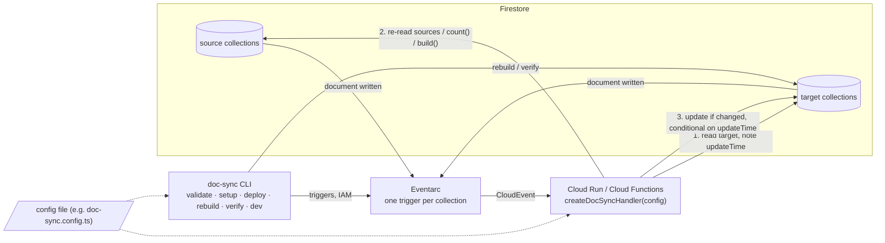

# firestore-denormalize

Keep derived Firestore data correct with **one Cloud Run function and one Eventarc trigger per collection**.

[日本語版 README](./README.ja.md) · [Reference](./docs/reference.md) · [Changelog](./CHANGELOG.md)

You describe rules in one TypeScript file. The function re-reads the source documents on every change and writes the derived value only if it differs, conditional on the target's `updateTime`. Duplicate, late or reordered events cannot corrupt the result.

**Why this instead of Extensions or your own triggers**

- One function and one trigger per collection for any number of rules, instead of two functions per `firestore-connect-*` extension or one trigger per rule.
- Correct under Eventarc's at-least-once, unordered delivery: values are re-read, never taken from the event, and never `increment()`ed.
- `rebuild` backfills existing data and `verify` proves it is correct, with the same code the live handler runs.
- `validate` prints the reads and writes one event causes before anything is deployed.

**Status**: 0.x. The API is stable in shape but may still change before 1.0, and the package has not yet been validated in a production project.

## Three kinds of rules

**Copy** (`connections`): fields of one document, copied into every document that points at it.

```ts
{
  name: 'post-category',
  source: 'category',
  target: 'post',
  idField: 'categoryId',
  fields: ['name', 'color'],
  targetField: 'category',
  onSourceDelete: 'setNull',
}
```
```
category/c1   { name: 'News', color: 'red', slug: 'news' }
post/p1       { title: 'Hello', categoryId: 'c1' }
                                   ▼
post/p1       { title: 'Hello', categoryId: 'c1', category: { name: 'News', color: 'red' } }
```

**Count / sum** (`aggregates`): a number over the documents that belong to the target, always recomputed with `count()` / `sum()`.

```ts
{
  name: 'post-likes',
  source: 'post/{postId}/like',
  target: 'post',
  idParam: 'postId',
  aggregate: 'count', // or { sum: 'amount' }
  targetField: 'likeCount',
}
```
```
post/p1/like/u1, post/p1/like/u2
post/p1       { title: 'Hello' }
                                   ▼
post/p1       { title: 'Hello', likeCount: 2 }
```

**View** (`views`): a value your own `build` computes from one or more sources. For latest-N lists, maps keyed by id, summaries.

```ts
defineView({
  name: 'post-latest-comments',
  target: 'post',
  targetField: 'latestComments',
  sources: {
    comments: {
      collection: 'post/{postId}/comment',
      idParam: 'postId',
      orderBy: [['createdAt', 'desc']],
      limit: 2,
    },
  },
  build: ({ sources }) => sources.comments.map((c) => ({ id: c.id, body: c.get('body') })),
})
```
```
post/p1/comment/c1 { body: 'first', createdAt: 1 } … c3 { body: 'third', createdAt: 3 }
post/p1       { title: 'Hello' }
                                   ▼
post/p1       { title: 'Hello', latestComments: [{ id: 'c3', body: 'third' }, { id: 'c2', body: 'second' }] }
```

All options, including `patch` for views and typed configs, are in the [reference](./docs/reference.md#config).

## How it works



Step 1 happens before step 2, so a value computed from a stale read can never pass the precondition in step 3. Details: [how a change is processed](./docs/reference.md#how-a-change-is-processed).

## Quick start

Requires Node.js 20+, `firebase-admin` 12+, the `gcloud` and `firebase` CLIs, and Firestore in Native mode.

```sh
npm install firestore-denormalize
```

**1. Config.** Put the config file (e.g. `doc-sync.config.ts`; any name works, pass it with `--config`) in `functions/src/` so `firebase deploy` ships it. A complete example: [examples/functions/src/doc-sync.config.ts](./examples/functions/src/doc-sync.config.ts).

**2. Function.** Expose the handler as an HTTP function. `invoker` is required; without it the function is public.

```ts
// functions/src/index.ts
import { initializeApp } from 'firebase-admin/app'
import { onRequest } from 'firebase-functions/v2/https'
import { createDocSyncHandler } from 'firestore-denormalize'
import config from './doc-sync.config'

initializeApp()

export const docSync = onRequest(
  { region: 'asia-northeast1', invoker: 'doc-sync-trigger@<project>.iam.gserviceaccount.com' },
  createDocSyncHandler(config),
)
```

**3. Service account, deploy, triggers.**

```sh
npx doc-sync setup  --project <project> --config functions/src/doc-sync.config.ts   # once: SA, IAM, APIs
firebase deploy --only functions:docSync
npx doc-sync deploy --project <project> --config functions/src/doc-sync.config.ts   # creates / updates / deletes triggers
```

**4. Existing data.**

```sh
npx doc-sync rebuild --project <project> --config functions/src/doc-sync.config.ts --dry-run   # then without --dry-run
npx doc-sync verify  --project <project> --config functions/src/doc-sync.config.ts             # exits 1 on mismatch; --fix repairs
```

## CLI

```
doc-sync validate [--config <path>] [--strict]                       # check config, show cost estimate
doc-sync setup    [--config <path>] [--project <id>] [--dry-run]
doc-sync deploy   [--config <path>] [--project <id>] [--dry-run] [--deploy-function <name>]
doc-sync rebuild  [--config <path>] [--project <id>] [--dry-run] [--rule <name>]... [--start-after <path>] [--page-size <n>]
doc-sync verify   [--config <path>] [--project <id>] [--fix] [--rule <name>]... [--start-after <path>] [--page-size <n>]
doc-sync dev      [--config <path>] [--project <id>] --url <handler url> [--emulator-host <host:port>]
```

`validate` also prints, per rule, the reads and writes one event causes (as formulas over the number of matching targets) and warns about expensive shapes, so cost is visible before deploy. `rebuild`, `verify` and `dev` use Application Default Credentials, or the Firestore emulator when `FIRESTORE_EMULATOR_HOST` / `--emulator-host` is set. Flag details: [reference](./docs/reference.md#cli).

## Local development

The Emulator Suite has no Eventarc, so `doc-sync dev` listens to the Firestore emulator and POSTs each change to your function as a CloudEvent, exactly as Eventarc would.

```sh
firebase emulators:start --only firestore,functions
FIRESTORE_EMULATOR_HOST=127.0.0.1:8080 npx doc-sync dev --project demo-app \
  --config functions/src/doc-sync.config.ts --url http://127.0.0.1:5001/demo-app/asia-northeast1/docSync
```

## Read next

- [Reference](./docs/reference.md): every config option, typed configs, processing rules, logs, cost estimate, security, limitations, recommended function settings.
- [ROADMAP](./ROADMAP.md) and [CHANGELOG](./CHANGELOG.md).

## Development

```sh
npm install && npm run typecheck && npm test   # tests run against the Firestore emulator (needs firebase-tools and Java)
npm run build                                   # ESM + CJS + .d.ts into dist/
```

## License

MIT
