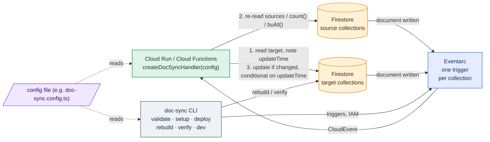

# firestore-denormalize

Keep data in sync between Firestore documents with **one Cloud Run function and one Eventarc trigger per collection**.

[日本語版 README](./README.ja.md) · [Reference](./docs/reference.md) · [Changelog](./CHANGELOG.md)

## Status

0.x beta. Breaking changes may still happen.

## Features

- 👍 One function syncs every collection. The code stays easy to follow, and a single always-on instance handles the sync quickly with no cold starts.
- 👍 Syncing in Cloud Functions keeps the client-side write rules simple.
- 👍 Handles Eventarc's delivery guarantees (at least once, no ordering) correctly and syncs exactly the intended data. Values are re-read rather than taken from the event, and `increment()` is never used.
- 👍 `rebuild` backfills existing data.
- 👍 `verify` checks stored data for anything the sync missed.
- 👍 `validate` estimates the reads and writes per event before you deploy.
- 👍 Any rule can run on a Cloud Scheduler cron instead of on events (`schedule: '0 3 * * *'`), still with one function.

## What this library does

Everything is a **view**: a rule that keeps declared fields of a target document equal to a value computed from other documents. The three other rule kinds are shorthands for views of a fixed shape; use them when they fit and drop down to `defineView` when they do not.

**View** (`defineView`): the general form. Reacts to changes on the target, its sources or its `base`, and writes the field paths you declare in `targetFields`, nested or at the root. For latest-N lists, maps keyed by id, summaries, read models. With `base`, the target document itself is created and deleted along with the same-id base document.

```ts
defineView({
  name: 'post-latest-comments',
  target: 'post',
  targetFields: ['latestComments'],
  sources: {
    comments: {
      collection: 'post/{postId}/comment',
      idParam: 'postId',
      orderBy: [['createdAt', 'desc']],
      limit: 2,
    },
  },
  build: ({ sources }) => ({ latestComments: sources.comments.map((c) => ({ id: c.id, body: c.get('body') })) }),
})
```
```
post/p1/comment/c1 { body: 'first', createdAt: 1 } … c3 { body: 'third', createdAt: 3 }
post/p1       { title: 'Hello' }
                                   ▼
post/p1       { title: 'Hello', latestComments: [{ id: 'c3', body: 'third' }, { id: 'c2', body: 'second' }] }
```

**Projection** (`defineProjection`): shorthand for a view with `base` and no `build`. A read model in another collection: `userPublicView/{id}` exists exactly when `user/{id}` does and carries the declared paths copied as they are. Add aggregates or views on `userPublicView` for derived fields.

```ts
defineProjection({
  name: 'user-public',
  base: 'user',
  target: 'userPublicView',
  targetFields: ['displayName', 'avatarUrl'],
})
```
```
user/u1             { displayName: 'Ann', avatarUrl: '…', email: 'ann@…', phone: '…' }
                                   ▼
userPublicView/u1   { displayName: 'Ann', avatarUrl: '…' }
```

**Copy** (`defineConnection`): shorthand for a view with one `refField` source. Copies fields of a document into the related documents that point at it, under one target field.

```ts
defineConnection({
  name: 'post-category',
  source: 'category',
  target: 'post',
  idField: 'categoryId',
  fields: ['name', 'color'],
  targetField: 'category',
  onSourceDelete: 'setNull',
})
```
```
category/c1   { name: 'News', color: 'red', slug: 'news' }
post/p1       { title: 'Hello', categoryId: 'c1' }
                                   ▼
post/p1       { title: 'Hello', categoryId: 'c1', category: { name: 'News', color: 'red' } }
```

**Count / sum** (`defineAggregate`): shorthand for a view whose value is a count or a sum. Uses a Firestore aggregation query instead of reading the documents, so it stays cheap for large collections.

```ts
defineAggregate({
  name: 'post-likes',
  source: 'post/{postId}/like',
  target: 'post',
  idParam: 'postId',
  aggregate: 'count', // or { sum: 'amount' }
  targetField: 'likeCount',
})
```
```
post/p1/like/u1, post/p1/like/u2
post/p1       { title: 'Hello' }
                                   ▼
post/p1       { title: 'Hello', likeCount: 2 }
```

**Scheduled instead of event-driven**: add `schedule` to any rule and it is synced by a Cloud Scheduler job calling the same function (`/schedule/<rule>`) rather than by Firestore events. For large fan-outs, nightly aggregates, or read models that may lag. Runs that exceed the time budget continue in chunks through a Cloud Tasks queue, with the cursor in the task, so nothing is written to your data.

```ts
defineAggregate({ name: 'daily-likes', source: 'post/{postId}/like', target: 'post', idParam: 'postId', aggregate: 'count', targetField: 'likeCount', schedule: '0 3 * * *', timeZone: 'Asia/Tokyo' })
```

Targets are never created by connections, aggregates or views without `base`: they fill fields of documents that already exist. A view with `base` (and a projection) is the one exception and owns its target's existence.

These go into the config's `rules` array, in any order, so rules can be grouped by domain and split across files.

All options, including `patch` for views and typed configs, are in the [reference](./docs/reference.md#config).

## How it works



Step 1 happens before step 2, so a value computed from a stale read can never pass the precondition in step 3. Details: [how a change is processed](./docs/reference.md#how-a-change-is-processed).

## Quick start

Requires Node.js 20+, `firebase-admin` 12+, the `gcloud` and `firebase` CLIs, and Firestore in Native mode.

```sh
npm install firestore-denormalize
```

**1. Put the config file (e.g. `doc-sync.config.ts`) in `functions/src/`.** [Sample config](./examples/functions/src/doc-sync.config.ts).

**2. Expose the handler as an HTTP function. `invoker` is required.** (Without it the function is public.)

```ts
// functions/src/index.ts
import { initializeApp } from 'firebase-admin/app'
import { onRequest } from 'firebase-functions/v2/https'
import { createDocSyncHandler } from 'firestore-denormalize'
import config from './doc-sync.config'

initializeApp()

export const docSync = onRequest(
  {
    region: 'asia-northeast1',
    invoker: 'doc-sync-trigger@<project>.iam.gserviceaccount.com',
    timeoutSeconds: 300, // raise to 1800 (≥ schedule.budgetMs) once a rule has `schedule`
  },
  createDocSyncHandler(config),
)
```

**3. Set up the service account, deploy, create the triggers.**

```sh
npx doc-sync setup  --project <project> --config functions/src/doc-sync.config.ts   # once: SA, IAM, APIs
firebase deploy --only functions:docSync
npx doc-sync deploy --project <project> --config functions/src/doc-sync.config.ts   # creates / updates / deletes triggers
```

**4. Backfill existing data.**

```sh
npx doc-sync rebuild --project <project> --config functions/src/doc-sync.config.ts --dry-run   # then without --dry-run
npx doc-sync verify  --project <project> --config functions/src/doc-sync.config.ts             # exits 1 on mismatch; --fix repairs
```

## CLI

```shell
# Check the config; list triggers and the cost estimate (--strict fails on warnings)
doc-sync validate [--config <path>] [--strict]

# Create the trigger service account, grant IAM roles, enable APIs (once; safe to rerun)
doc-sync setup    [--config <path>] [--project <id>] [--dry-run]

# Create / update / delete Eventarc triggers to match the config (--deploy-function runs firebase deploy first)
doc-sync deploy   [--config <path>] [--project <id>] [--dry-run] [--deploy-function <name>]

# Walk every existing target and bring it in line with its sources (backfill; --dry-run only reports)
doc-sync rebuild  [--config <path>] [--project <id>] [--dry-run] [--rule <name>]... [--start-after <path>] [--page-size <n>]

# Recompute derived values and report mismatches (--fix repairs; exits 1 while any remain)
doc-sync verify   [--config <path>] [--project <id>] [--fix] [--rule <name>]... [--start-after <path>] [--page-size <n>]

# Forward Firestore emulator changes to the handler as CloudEvents (local development)
doc-sync dev      [--config <path>] [--project <id>] --url <handler url> [--emulator-host <host:port>]
```

`validate` prints, per rule, the reads and writes one event causes (as formulas over the number of matching targets) and warns about expensive shapes, so cost is visible before deploy.

`rebuild`, `verify` and `dev` use Application Default Credentials, or the Firestore emulator when `FIRESTORE_EMULATOR_HOST` / `--emulator-host` is set. See the [reference](./docs/reference.md#cli) for flag details.

## Local development

The Emulator Suite has no Eventarc, so `doc-sync dev` listens to the Firestore emulator and POSTs each change to your function as a CloudEvent, exactly as Eventarc would.

```sh
firebase emulators:start --only firestore,functions
FIRESTORE_EMULATOR_HOST=127.0.0.1:8080 npx doc-sync dev --project demo-app \
  --config functions/src/doc-sync.config.ts --url http://127.0.0.1:5001/demo-app/asia-northeast1/docSync
```

## Read next

- [Reference](./docs/reference.md): every config option, typed configs, processing rules, logs, cost estimate, security, limitations, recommended function settings.
- [CHANGELOG](./CHANGELOG.md).

## Development

```sh
npm install && npm run typecheck && npm test   # tests run against the Firestore emulator (needs firebase-tools and Java)
npm run build                                   # ESM + CJS + .d.ts into dist/
```

## License

MIT
